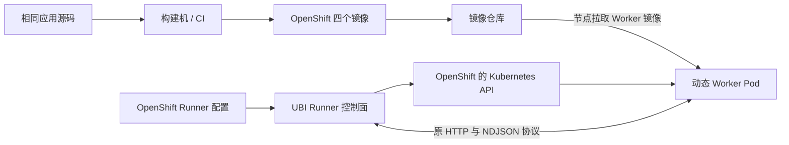

# SkillHub 可选 OpenShift 部署方式设计

> 版本：v0.14；状态：四个组件的 OpenShift 镜像配方已交付；基础市场试部署清单与完整构建安装指导已交付；Runner/Worker 的集群部署仍为后续设计。
> 唯一代码基线：`1c5ad91a9b57b4c656eff7f6f438cf96ee19e6ab`。
> 本轮交付四个独立 Dockerfile、Backend/Frontend 部署清单及手工安装文档；应用业务代码和原有部署文件保持不变。实际 OCP 验收先覆盖 Backend/Frontend。

## 1. 设计目标与用户审查意见

本方案为 SkillHub 增加用户可选择的 OpenShift 部署方式，与现有 Kubernetes、Docker 和源码开发方式并存。

| 用户要求 | 本方案的设计决定 |
| --- | --- |
| 新增部署方式，原方案尽量不动 | 新增独立目录及构建、配置入口；现有四个 Dockerfile、K8s 清单、Compose 不修改 |
| 原前端保留 Node 20 | 原 `docker/Dockerfile.skillhub-frontend` 完整保留 |
| OpenShift 前端使用 Node 22、Nginx 1.27 Alpine | 新 Dockerfile 构建阶段使用 `node:22-alpine`，运行阶段使用 `nginx:1.27-alpine` |
| UBI 主要替换 Python 基础镜像 | 新 Backend、Runner、Worker 使用 UBI Python；不将前端强行统一为 UBI |
| 只有 UBI 镜像要求 DNF | 三个 Python 最终镜像验证完整 DNF；前端不要求 DNF |
| Runner 管理 OpenShift Worker | 复用现有 K8s executor；部署时为 Worker 项目选择 SCC 允许的数值 UID，不改 Pod 生成代码 |
| 容器日志 | 以现有控制台输出进入集中采集；文件日志沿用原 K8s 部署的容器可写层，不把文件日志等同于 stdout |
| 与前后端业务代码解耦 | 应用、Runner 和 Worker 的 Python/前端源码均保持；部署选择由镜像、清单和配置完成 |
| 安装方式 | OCP 4.16 Web 控制台人工操作为主，不要求安装者使用 `oc`、Shell 渲染器或本地构建工具 |

本版按用户确认的验收目标审查纯镜像与清单路线：必要的现有控制台日志进入集中采集，`interface.log` 沿用原 K8s 方式写入 Marketplace 容器可写层，不要求进入集中采集，也不增加 sidecar。`auto` UID 和可选 stdout 代码扩展不纳入本版实施边界。Worker/Agent-core 的实际日志覆盖仍须按第 10、14 节验证。

## 2. 需求范围与 issue 对应关系

- [#245](https://gitcode.com/openJiuwen/skillhub/issues/245)：对应新增 UBI Python 镜像、完整 DNF、派生构建、OpenShift 权限适配及日志方案。
- [#246](https://gitcode.com/openJiuwen/skillhub/issues/246)：本方案在新增 OpenShift 前端构建路线提供 Node 22，原路线保留 Node 20。

保留原 Node 20 是用户明确提出的产品兼容要求。因此 PR 只能准确说明“新增 Node 22 的部署选择”，不能宣称项目所有 Node 20 已被移除。如果维护者认为 #246 要求全项目升级，需沟通贡献范围；在此之前不使用自动关闭该 issue 的承诺。

本次不改变数据库 SQL、资产格式、业务 API、模型协议和 Agent 版本，不新增另一套业务实现。

## 3. 两种部署方式与选择边界

| 项目 | 现有 Kubernetes / Docker 路线 | 新增 OpenShift 路线 |
| --- | --- | --- |
| 应用源码 | 基线代码 | 相同版本源码 |
| Backend / Runner | 原 Python 3.11 Debian 镜像 | UBI Python，优先保持 3.11 |
| Worker | 原 Python 3.12 slim 镜像 | UBI Python 3.12 |
| Frontend builder | 原 Node 20 Alpine | `node:22-alpine` |
| Frontend runtime | 原 `nginx:alpine` | `nginx:1.27-alpine`，新增非 root 配置 |
| Python 系统包管理 | 原方案 | 完整 DNF |
| 前端系统包管理 | 原方案 | Alpine 自身方式；不提供 DNF |
| 构建入口 | 原 Dockerfile / Compose | 独立 OpenShift Dockerfile |
| 部署入口 | `docker/k8s` | `docker/openshift/manifests` 的独立 YAML 与 Web 控制台操作文档 |
| Worker 创建逻辑 | 现有 Runner K8s executor，固定 UID | 同一执行器，选择新 Worker 镜像与当前 Worker 项目允许的数值 UID |
| 用户操作 | 选择现有部署入口 | 选择 OpenShift 部署入口 |

“两种方式并存”指仓库提供两种可选交付物，不意味着必须同时运行两套服务。确需并行部署时使用不同命名空间、入口和镜像标签；是否共享数据库、Redis 和对象存储由部署方案明确指定，不能默认并行写入同一生产数据。

部署方式属于运维选择，不在 Web 页面增加开关，也不通过业务代码自动识别集群类型。

## 4. 目录与文件修改边界

以下是完整方案的目录规划。四个 Dockerfile 在 `dockerfiles/` 下平铺，前端运行配置集中在 `nginx/`；部署清单在 `manifests/` 下平铺，文件名以组件开头、资源类型结尾，便于同时识别归属和比较同类资源。目前只交付 Backend/Frontend 清单，Runner/Worker 清单与可选 NetworkPolicy 尚未交付。Worker 的 Pod 由 Runner 动态生成，所以不规划 `manifests/worker-deployment.yaml`：

```text
docker/openshift/
  README.md
  DEPLOYMENT.md
  dockerfiles/
    Dockerfile.backend
    Dockerfile.frontend
    Dockerfile.runner
    Dockerfile.worker
  nginx/
    nginx.conf
    default.root.conf.template
    default.hub.conf.template
    entrypoint.sh
  manifests/
    marketplace-secret.yaml
    marketplace-configmap.yaml
    marketplace-deployment.yaml
    marketplace-service.yaml
    marketplace-networkpolicy.optional.yaml
    frontend-deployment.yaml
    frontend-service.yaml
    frontend-route.yaml
    frontend-networkpolicy.optional.yaml
    runner-configmap.yaml
    runner-serviceaccount.yaml
    runner-deployment.yaml
    runner-service.yaml
    runner-networkpolicy.optional.yaml
    worker-serviceaccount.yaml
    worker-role.yaml
    worker-rolebinding.yaml
    worker-quota.optional.yaml
    worker-limitrange.optional.yaml
    worker-networkpolicy.optional.yaml
```

清单是普通 YAML，不依赖 `${...}` 插值或生成工具。清单文件前缀 `marketplace` 与原 K8s 目录一致，对应运行资源 `skillhub-backend`，不改变资源名或环境变量。ConfigMap 和 Secret 将当前代码支持的部署变量按功能分组：基础市场试部署项生效，其他可选项以注释展示用途和启用条件；兼容旧别名不重复列出。镜像、域名、外部服务、Worker 项目与 UID 等生效值使用明显的占位字符串，在 Web 控制台导入前人工替换；注释中的示例只有启用时才替换。项目在控制台创建，命名空间资源不写死 `metadata.namespace`，由操作者先选择正确项目。Worker 项目的 RoleBinding subject 仍需显式填入应用项目名。Marketplace 业务 Secret 可填值后在页面导入，也可以按键名在 Secrets 页面逐键创建；真实凭据不进入仓库。镜像拉取 Secret 仅在私有仓库需要：静态组件引用应用项目中的 Secret，动态 Worker 引用 Worker 项目中的 Secret。

### 4.1 每个目录和文件的职责

| 路径 | 职责与放置原因 |
| --- | --- |
| `docker/openshift/README.md` | 说明当前基础市场交付范围，并导航四个镜像配方、已交付清单和统一部署指导 |
| `DEPLOYMENT.md` | 基础市场从构建、推送两张镜像，到 OCP 页面准备项目/Secret、导入七份清单、验证业务与回退的完整操作指导；安装者不以 `oc` 为前提 |
| `dockerfiles/` | 平铺四个组件的 Dockerfile；所有构建均以仓库根目录为上下文，复用根目录 `.dockerignore` |
| `dockerfiles/Dockerfile.backend` | 构建 UBI Backend；保留 wheel、Git、检索和隐私声明能力，提供运行与客户派生目标 |
| `dockerfiles/Dockerfile.frontend` | 仅 OpenShift 前端使用 Node 22 构建和 Nginx 1.27 Alpine 运行；原 Dockerfile 不变 |
| `dockerfiles/Dockerfile.runner` | 构建 UBI Runner 控制面；仍安装同一份 skill-runner 包，不内置 Worker 工具集，保持集群内 8900 端口可达 |
| `dockerfiles/Dockerfile.worker` | 构建 UBI Worker；复用原 `docker/skill-agent-worker/entrypoint.sh`，保留 Agent-core、工具、词表、工作区及原日志行为 |
| `nginx/` | 前端新镜像独用的配置与入口，不放部署清单，也不改原 `frontend/nginx/*` |
| `nginx/nginx.conf` | 非 root Nginx 的主进程、PID、临时路径和日志配置 |
| `nginx/default.root.conf.template` | 前端部署在 `/` 时的静态资源、SPA、健康检查和 API 代理规则 |
| `nginx/default.hub.conf.template` | 前端部署在 `/hub` 时的同等规则及路径重写；与 root 模板二选一 |
| `nginx/entrypoint.sh` | 仅生成上游地址相关 Nginx 配置，然后启动 Nginx；不改已构建的 JS 资产 |
| `manifests/` | 当前平铺七份可在 OCP 页面逐项导入的基础市场 YAML；组件前缀标识归属，后续规划的可选清单使用 `.optional` 后缀 |
| `manifests/marketplace-secret.yaml` | 基础市场试部署的敏感值生效；其他敏感配置按功能注释列出，启用后填真实值；浏览场景可删去 OAuth 两项，真实值不保存到仓库 |
| `manifests/marketplace-configmap.yaml` | Marketplace 非敏感配置；生效项供本轮试部署，可选项分组注释并说明用途，密钥由独立 Secret 注入 |
| `manifests/marketplace-deployment.yaml` | Marketplace 镜像地址、Pod IP 监听、探针、资源、SCC 兼容的安全上下文和 ConfigMap/业务 Secret 引用；不挂载数据或日志卷，私有镜像拉取 Secret 由安装者按现场配置 |
| `manifests/marketplace-service.yaml` | Marketplace 8100 ClusterIP，供 Frontend 和可选内部客户端访问 |
| `manifests/marketplace-networkpolicy.optional.yaml` | 可选网络收紧：Marketplace 入站与数据库、存储、OAuth、模型、Redis 等已启用依赖的出站边界；先按集群现有策略核对 |
| `manifests/frontend-deployment.yaml` | 前端镜像地址、上游地址、端口、探针、安全上下文及可写临时路径；私有镜像拉取 Secret 由安装者按现场配置 |
| `manifests/frontend-service.yaml` | 前端 9002 ClusterIP，作为 Route 的唯一前端目标 |
| `manifests/frontend-route.yaml` | 用户入口与 TLS；OAuth 回调地址和浏览器可见对象存储地址需在部署指南中同步配置 |
| `manifests/frontend-networkpolicy.optional.yaml` | 可选网络收紧：允许入口控制器到 Frontend、Frontend 到 Backend 和必要的 DNS 流量 |
| `manifests/runner-configmap.yaml` | `SKILL_RUNNER_EXECUTOR=k8s`、Worker 镜像 digest/命名空间、项目允许的数值 UID、预热池和内部代理地址 |
| `manifests/runner-serviceaccount.yaml` | Runner 控制面使用的独立 SA；其跨命名空间权限在 Worker 项目绑定 |
| `manifests/runner-deployment.yaml` | 可选 Runner Deployment，镜像 digest、私有镜像所需拉取 Secret、Pod IP 上的 8900 端口、探针、资源、ServiceAccount、LLM Secret 等 |
| `manifests/runner-service.yaml` | Runner 8900 ClusterIP，供 Backend 转发与 Worker 回调 |
| `manifests/runner-networkpolicy.optional.yaml` | 可选网络收紧：Backend 到 Runner、Runner 到 Worker/K8s API/LLM 的必要通信 |
| `manifests/worker-serviceaccount.yaml` | Worker 专用最小身份，`automountServiceAccountToken: false`；不授予 Pod 管理权限 |
| `manifests/worker-role.yaml` | Worker 项目中仅管理 Worker Pod 所需的 Role，按现有 Runner API 调用核对资源和动词 |
| `manifests/worker-rolebinding.yaml` | 将上述 Role 绑定给应用项目中的 Runner SA；需人工填写 subject.namespace，避免误绑其他项目 |
| `manifests/worker-quota.optional.yaml` | 可选 Worker 项目总 Pod 数、CPU、内存预算；与现场可用资源核对后导入 |
| `manifests/worker-limitrange.optional.yaml` | 可选单个 Worker Pod 的缺省和允许的资源请求/限制；与 Runner 资源配置共同核对 |
| `manifests/worker-networkpolicy.optional.yaml` | 可选网络收紧：Worker 入站只接收 Runner，请求回 Runner 的 LLM 代理及必要 DNS；按目标网络插件验证 |

`backend` 和 `frontend` 是基础市场必需组件；`runner` 和 `worker` 共同构成可选 Playground。启用 Playground 时先准备 Worker 项目的身份与权限，并按现场策略设置配额，再部署 Runner。Worker 目录提供镜像和创建 Pod 所需的环境资源，没有静态 Worker Deployment 或 Service。

### 4.2 现有文件边界

保持不变的内容：

- 原四个 Dockerfile、`docker/k8s/*`、Compose 及 APT/Python 构建参数。
- 共享 `frontend/nginx/*` 文件；新路线采用独立配置，以回归测试约束路由语义一致。
- `frontend/src`、Backend 路由、服务、模型及接口。
- Runner 的 Session、executor、预热池、回收及 Pod manifest 生成逻辑。
- Python/npm 业务依赖版本及现有日志默认值。

不在新 Dockerfile 中通过 sed、复制替换 Python 文件或 monkey patch 改写应用，不能以“源码没变”掩盖镜像内的另一套代码。

本版不改 `skill-runner/config.py`、`skill-runner/executor/pod_manager.py`、`marketplace/plugins_market/core/logging.py`、`marketplace/plugins_market/core/interface_log.py` 或 `skill-runner/executor/local.py`。原 Dockerfile、`docker/k8s` 和 Compose 也不改。若后续确认接口日志必须直接进入容器日志，或必须支持完全自动分配 Worker UID，应重新审查前述通用扩展，不能在本版清单中虚构已有配置。

## 5. 镜像构建设计

### 5.1 三个 UBI Python 镜像

Backend、Runner、Worker 分别构建，维持原组件边界，不将 Worker 工具依赖装入 Backend 或 Runner 来合并服务。

优先保持 Backend/Runner Python 3.11、Worker Python 3.12。三个镜像目前以 **UBI 9 standard** 为基础，在构建阶段安装 Python 3.11/3.12 与系统依赖，并明确使用相应解释器；不能使用 UBI 9 默认 `python` 命令而意外运行 Python 3.9。最终镜像保留完整 `dnf`，供客户继续派生安装 RPM。[UBI 类型](https://catalog.redhat.com/en/software/base-images)、[Python 版本](https://docs.redhat.com/en/documentation/red_hat_enterprise_linux/9/html/installing_and_using_dynamic_programming_languages/assembly_installing-and-using-python_installing-and-using-dynamic-programming-languages)

`ubi9/python-311` 和 `ubi9/python-312`（名称中有连字符）同样符合 Python 与完整 DNF 的功能要求：2026-10-27 本地拉取并运行的两个镜像分别提供 Python 3.11.13/3.12.15 和 `dnf-4.14.0`，无需补装 DNF。它们预装 Python，更便于编写 Dockerfile；但本次实测 amd64 镜像解压后大小约为 1.55/1.53 GB，标准 UBI 约为 313 MB，拉取和存储成本更高。两个 Python 镜像的默认 `ENTRYPOINT` 是 `container-entrypoint`，该脚本仅将参数交给目标进程；默认 `CMD` 是 S2I 用法说明。应用 Dockerfile 应设置自己的启动命令，但无须仅为移除该包装脚本覆盖 `ENTRYPOINT`。构建时 UID 和工作目录仍需按应用安装步骤处理。当前试部署保留已验证的 standard 路线，选择依据是更小的基础层。若优先减少 Dockerfile 的 Python 安装步骤，可以另做 Python 镜像方案并比较最终镜像大小、构建时间和 OCP 启动。[Python 3.11 镜像](https://catalog.redhat.com/software/containers/ubi9/python-311/63f764b03f0b02a2e2d63fff)、[Python 3.12 镜像](https://catalog.redhat.com/software/containers/ubi9/python-312/657b08d023df896ebfacf402)

三个 Python Dockerfile 默认使用同一个已核对的 UBI 9 standard `版本标签@多架构摘要`。前端的 Node 22 Alpine 和 Nginx 1.27 Alpine 也使用相同写法：标签帮助阅读版本，摘要确定实际拉取内容。更新底座时审查、测试并在 PR 中更换摘要。摘要固定底座，但 RPM 仓库、Backend/Worker 的 Python 依赖解析和 Runner 缺失的 `uv.lock` 仍可使不同日期的构建产生差异。当前部署应交付并引用最终产物摘要；若要求跨日期重建一致，还需固定 RPM 仓库快照和 Python 的传递依赖，并核对产物。详见 `openshift/DEPLOYMENT.md`。[Docker 构建建议](https://docs.docker.com/build/building/best-practices/#pin-base-image-versions)

三者最终运行镜像均需通过 `dnf --version` 及各自 `python3.11 --version` 或 `python3.12 --version`；不能只在 builder 存在 DNF，也不能用 `microdnf` 代替完整 DNF。构建方在交付镜像时提供镜像仓库地址、digest、构建源码提交及这两项验证记录，供只使用 Web 控制台的安装者核对。

保留原镜像能力：

| 镜像 | 必须保留 |
| --- | --- |
| Backend | wheel 安装、Git/证书、retrieval 独立源码及导入方式、隐私声明、数据和缓存、8100 与健康端点 |
| Runner | 独立控制面、原 Python 入口与包路径、8900、K8s 客户端、现有镜像源参数 |
| Worker | Agent-core/observability、原工具依赖、tiktoken 预加载、8080、工作区和入口语义 |

构建时处理系统包、权限和依赖；运行时不执行 DNF、chown 或提权。镜像内 `/app` 的数据/缓存目录、Runner 临时会话目录、Worker `HOME`、`/workspace`、tiktoken 缓存按任意 UID 可写设计：在构建阶段只对必要路径设置 root 组所有权和组写/执行权限，避免运行时修复所有权或放开整棵目录的 world-writable 权限。Red Hat 的 OpenShift 镜像指南建议该组权限模式；仍须以实际 SCC、UID 和启动业务功能验证。[OCP 4.16 任意 UID 镜像指南](https://docs.redhat.com/en/documentation/openshift_container_platform/4.16/html-single/images/index)

若后续采用 Python S2I 镜像，显式设置应用的启动命令、工作目录和 Python 环境，并验证 Kubernetes 的 command 覆盖场景。Runner 新镜像或 Deployment 必须明确监听 Pod IP/可达地址，不能直接沿用原镜像仅监听 `127.0.0.1` 的默认 CMD，否则 Backend Service 无法调用 Runner；端口仍为 8900。

### 5.2 OpenShift 前端镜像

新增前端 Dockerfile 使用：

```dockerfile
# 仅表示版本线；实际 Dockerfile 使用固定的多架构摘要。
FROM node:22-alpine@sha256:<已核对摘要> AS builder
# npm ci、现有锁文件、Vite 构建

FROM nginx:1.27-alpine@sha256:<已核对摘要> AS runtime
# 静态产物、独立配置、任意非 root UID 入口
```

保留 `FRONTEND_BASE_PATH`、`VITE_API_BASE_URL`、根路径及 `/hub` 构建，保留 `BACKEND_URL` / `BACKEND_PORT` 的运行时上游配置。

运行端口仍为 9002。Nginx 不依赖固定用户切换，PID、生成配置和请求临时文件位于任意 UID 可写目录；不能假定官方镜像入口能以随机 UID 写 `/etc/nginx/conf.d`。仅替换上游地址变量，保留 `$uri` 等 Nginx 变量。保留 SPA、代理、上传限制、gzip、健康检查和安全响应头。

Node 仅用于构建，不进入最终前端镜像。镜像可部署 OpenShift 不代表必须基于 UBI；该前端不承担 DNF 要求。

按用户指定的版本线选择，具体可拉取 tag、digest、依赖兼容性和扫描结果另行验证；未经用户同意不自行替换版本线，也不把指定版本等同于已完成安全验收。

### 5.3 运行目标与客户派生目标

仅对三个 UBI Python Dockerfile 设计：

| 目标 | 身份及用途 |
| --- | --- |
| `runtime`，默认 | 数值非 root，直接部署 |
| `derivative-base` | 构建阶段 UID 0，供客户继续执行 DNF |

后续完整交付可分别发布 `:<版本>-ocp` 和 `:<版本>-ocp-base`，不覆盖原 `latest` 标签。本轮试部署只要求发布 Backend `runtime` 镜像；该镜像保留完整 DNF，客户也可在派生构建时显式切换 `USER 0` 后安装 RPM。派生后运行必须强制非 root；OCP Deployment 只能填写 runtime 镜像 digest，不把 root 构建目标作为工作负载镜像导入。

构建阶段禁止 UID 0 的平台无法通过这一方式安装系统 RPM，需要另行设计。额外仓库凭据通过构建 secret 或受控配置提供，不进入镜像层。前端不提供 DNF 派生目标。

## 6. Runner 与 Worker：构建和运行职责

### 6.1 谁构建镜像

构建机或 CI 依次构建 Backend、Frontend、Runner、Worker 并推送仓库，交付镜像 digest。OCP 安装者只需能在页面填写 digest 并让集群拉取镜像；本方案不要求其在集群内运行构建命令，也不要求以 Web 控制台的“从 Git 导入”替代已经审查过的 Deployment YAML。

Runner 不构建 Worker 镜像，不执行 Docker/Podman，不需要宿主机 Docker socket，也不在集群里运行 DNF。它只创建引用已发布镜像的 Pod。



### 6.2 Runner 镜像如何构建

新增 Runner Dockerfile 安装同一份 `skill-runner` 源码与依赖，保持模块入口。Deployment 仍以 K8s executor 运行，使用独立 Runner SA。更换基础系统和运行配置，不另写 OpenShift executor。

### 6.3 如何选择 OpenShift Worker

复用当前代码已经读取的变量。以下为人工填写的 ConfigMap 片段示意，`REPLACE_ME` 必须在页面导入前替换：

```yaml
data:
  SKILL_RUNNER_EXECUTOR: "k8s"
  SKILL_RUNNER_K8S_NAMESPACE: "REPLACE_ME_WORKER_PROJECT"
  SKILL_RUNNER_K8S_POD_IMAGE: "REPLACE_ME_WORKER_IMAGE_DIGEST"
  SKILL_RUNNER_K8S_IMAGE_PULL_POLICY: "IfNotPresent"
  SKILL_RUNNER_K8S_IMAGE_PULL_SECRETS: ""  # 私有仓库时填写 Worker 项目中的 Secret 名
  SKILL_RUNNER_K8S_SERVICE_ACCOUNT: "skillhub-worker"
  SKILL_RUNNER_POD_PRIVILEGED: "false"
  SKILL_RUNNER_POD_RUN_AS_USER: "REPLACE_ME_ALLOWED_NUMERIC_UID"
  SKILL_RUNNER_POD_SECCOMP_PROFILE: "RuntimeDefault"
  SKILL_RUNNER_PROXY_BASE_URL: "http://skill-runner.REPLACE_ME_APP_PROJECT.svc:8900"
  SKILL_RUNNER_POOL_SIZE: "0"
```

私有 Worker 镜像的拉取 Secret 必须在 Worker 项目单独创建并由动态 Pod 引用；公开镜像可留空。Runner 的 SA 不自动赋予 Worker 拉取凭据。首轮人工安装将预热池设为 0，完成一次真实 Worker 创建与执行验收后再按容量调整。

原创建、等待 Ready、provision、执行、上传、reset、令牌绑定和回收流程保持。支持 pool_size=0 及大于 0 两种模式，复用池须验证连续会话清理。

多实例时继续使用原实例回调逻辑，不把所有 Worker 回调强制转到统一 Service。首版专用清单以单副本为默认值，不借本次部署工作重构会话高可用。

## 7. UID 方案：部署期选取 Worker 数值 UID

### 7.1 当前代码与配置边界

`skill-runner/config.py` 将 `SKILL_RUNNER_POD_RUN_AS_USER` 解析为整数，`pod_manager.py` 在动态 Worker Pod 和容器两层写入 `runAsUser`；直接填写 `auto` 会在配置解析时失败。新 OpenShift Runner ConfigMap 必须填入 Worker 项目允许的正整数 UID。静态 Backend、Frontend、Runner Deployment 则省略固定 UID，让各自的 SCC 处理。三个 Python 镜像和前端运行镜像均按不同项目 UID 做兼容设计。

OpenShift 4.16 的 `restricted-v2` SCC 通常依据项目的 UID 范围验证显式 UID；具体准入以实际 Worker SA 可使用的 SCC 为准，不能只看项目注解。[OpenShift 4.16 SCC 文档](https://docs.redhat.com/en/documentation/openshift_container_platform/4.16/html/authentication_and_authorization/managing-pod-security-policies)

### 7.2 准入和运行验证

1. 在 OCP 控制台创建或选择应用与 Worker 项目。具有权限的操作者从 Worker 项目的 YAML/详情查看 UID 范围，并请集群管理员确认 Worker SA 实际可使用的 SCC；不能默默使用默认 65534。
2. 在导入 Runner ConfigMap 前填入允许范围内的数值 UID，记录项目名、UID、SCC 和核验人。若页面不能显示必要的策略信息，由管理员提供；不能凭猜测导入。
3. 启动 Runner 后触发一次实际 Worker 创建，在项目的 Pod 详情、Events、YAML 和 Logs 页面检查准入结果、进程 UID、文件权限及入口；Backend、Frontend、Runner 也分别验证任意 UID 启动。
4. 在 UID 范围不同的测试项目重复镜像启动检查。Worker 项目重建或 SCC 变化时重新核验并在页面更新 Runner ConfigMap 与 Deployment。

本方案不要求安装者运行命令行 dry-run；页面导入成功也不能替代真实启动验证。本版不创建自定义 SCC，不授予 `anyuid` 或 `privileged`，也不增加修改 Pod 请求的 webhook。若目标集群策略拒绝显式 UID，应停止并重新评估 `auto` 通用扩展，而不是自动放宽 SCC。

### 7.3 静态组件的安全上下文

Backend、Frontend、Runner 的 Deployment 不写固定 `runAsUser`，由所在项目的 SCC 决定；容器设置非 root、禁止权限提升、丢弃额外 capabilities，并使用 `RuntimeDefault` seccomp，实际可用字段以目标 OCP 4.16 集群准入结果为准。Backend 和 Frontend 不需访问 Kubernetes API，禁用自动挂载 SA token；Runner 需要通过自己的 SA 调用 Kubernetes API，保留令牌挂载，但只在 Worker 项目获得所需 Role 权限。需要写入的路径靠镜像权限及对应卷解决，不把关闭安全限制作为权限故障的默认修复。

## 8. 动态 Worker manifest 示例

下面是将 Worker 项目允许的 UID 配入现有 Runner 后，动态生成 Pod 的核心字段示意；它不是安装者在页面导入的 Worker 清单，也不是集群导出结果：

```yaml
apiVersion: v1
kind: Pod
metadata:
  name: skill-agent-pool-example
  labels:
    app: skill-agent-worker
    managed-by: skill-runner
spec:
  restartPolicy: Never
  activeDeadlineSeconds: 3600
  serviceAccountName: skillhub-worker
  imagePullSecrets:
    - name: worker-registry
  securityContext:
    runAsNonRoot: true
    runAsUser: 1000780000  # 示例值，必须按目标 Worker 项目及 SCC 验证
    seccompProfile:
      type: RuntimeDefault
  containers:
    - name: worker
      image: registry.example.com/skillhub/worker@sha256:<实际摘要>
      securityContext:
        runAsNonRoot: true
        runAsUser: 1000780000
        allowPrivilegeEscalation: false
        capabilities:
          drop: [ALL]
        seccompProfile:
          type: RuntimeDefault
      # env、端口、readinessProbe 等仍由原代码生成，此处省略。
```

Pod 和容器层的 UID 必须相同且属于实际准入策略允许范围。命名空间由 `create_namespaced_pod` 的参数指定。固定寿命值同样是部署配置示例，不代表修改代码默认值。

显式指定 Worker SA 后，当前生成逻辑不再主动设置 automountServiceAccountToken=false。新增 Worker SA 自身应设 `automountServiceAccountToken: false`，避免无意挂载 API 凭据；SA 身份仍可参与准入。Worker 不需要 Pod 管理 RBAC。

## 9. 按组件部署的依赖与资源

| 顺序 | Web 控制台操作 / 清单 | 安装责任与依赖 |
| --- | --- | --- |
| 1 | 项目页面 | 创建或选择应用项目；启用 Playground 才创建 Worker 项目。Project 创建权限不足时由集群管理员准备 |
| 2 | Secrets 页面或 `manifests/marketplace-secret.yaml` | 基础市场业务 Secret 可逐键创建，或替换清单占位值后导入；私有仓库拉取 Secret 单独创建。后续启用 Playground 时，Worker 项目的拉取 Secret 在其项目单独创建 |
| 3 | `manifests/marketplace-*.yaml` | 在应用项目依次导入 ConfigMap、Deployment、Service，确认后端健康；NetworkPolicy 按现场策略决定何时导入 |
| 4 | `manifests/frontend-*.yaml` | 在应用项目依次导入 Deployment、Service、Route，核对 TLS、外部域名及 Backend 代理 |
| 5，可选 | `manifests/runner-serviceaccount.yaml` | 先在应用项目创建 Runner SA，供跨项目 RoleBinding 指向 |
| 6，可选 | `manifests/worker-*.yaml` | 在 Worker 项目逐个创建 Worker SA、Role、RoleBinding；Quota、LimitRange、NetworkPolicy 按现场策略导入，此时没有静态 Worker Pod |
| 7，可选 | `manifests/runner-*.yaml` | 回应用项目导入 Runner ConfigMap、Deployment、Service；先关闭预热池，真实执行一次会话后再调整 |

资源清单的文件归属与职责见 4.1 节。每次导入前先在页面核对当前项目；清单不写死 `metadata.namespace`。Worker 项目的 Role/RoleBinding 对应用项目中的 Runner SA 授权，RoleBinding 的 subject.namespace 必须人工填写真实应用项目，仅涵盖现有 Runner 实际使用的 Pod 操作。权限不足时由项目管理员导入这些清单，不以获取集群管理员令牌作为应用运行条件。

NetworkPolicy、Quota、LimitRange 标为可选，避免在首次人工安装时因未经核对的限制导致服务不可用；如果集群已经默认拒绝流量或要求配额，则应由管理员先完成对应规则再启动工作负载。NetworkPolicy 必须按目标集群网络插件和实际外部服务地址验证，不交付任意集群通用的盲目放行规则。不要默认允许 Worker 直连持有真实密钥的外部模型入口。

数据库和对象存储继续外置，原 SQL 初始化流程保持；不通过 OpenShift 部署隐含引入数据库迁移。浏览器直连的对象存储预签名地址、OAuth 回调和 SSE 代理链需独立验收。

支持基础市场与市场加 Playground 两个安装集合。未启用 Playground 时，不部署 Runner、Worker 相关权限和预热资源。

## 10. 日志与写入路径

### 10.1 无 sidecar 的集中采集边界

现有 Backend `setup_logging` 已将应用、框架、访问日志输出到控制台，同时还写轮转文件；接口 logger 单独写 `interface.log`，且关闭文件 handler 的现有开关不会自动补上控制台 handler。原 K8s 和新 OpenShift 的 Marketplace Deployment 都不挂载数据或日志卷。`INTERFACE_LOG_DIR` 指向镜像内已创建的 `/app/logs`，文件写入容器可写层；需用实际 SCC 和 UID 验证目录可写。文件内容**不会**因此出现在 OCP Pod Logs 页面或常规容器 stdout/stderr 采集中。[Kubernetes 日志架构](https://kubernetes.io/docs/concepts/cluster-administration/logging/)

无 sidecar 的本版拟将 Backend 应用、框架、访问日志，Runner 控制面日志和 Nginx 访问/错误日志作为常规容器日志采集对象。`interface.log` 仅写容器可写层，容器重新创建后丢失，不属于集中采集结果。Worker 的 Uvicorn/Runner 日志及 Agent-core 日志须在 OCP 真正执行一次会话并检查；当前无法仅凭镜像和静态清单保证 Agent-core 的所有文件日志进入集中采集。

本版不暗中使用镜像启动脚本 `tail`、软链接 `/dev/stdout`、构建时替换 Python 文件等变通方式。若 OCP 验证发现 Agent-core 有必须集中采集而仅写文件的日志，应先核对是否能通过依赖的公开配置实现；解决不了则重新审查验收边界或通用日志扩展，不能宣称已通过。Python `RotatingFileHandler` 的轮转会关闭并重命名文件，不能把普通轮转文件直接等同于稳定的 stdout 目标。[Python 官方文档](https://docs.python.org/3.11/library/logging.handlers.html#rotatingfilehandler)

### 10.2 数据与临时路径

镜像需核对 Git clone/staging、检索本地化、推荐包下载及固定摘要、Runner 本地 Session 目录、Worker HOME/cache/workspace/tiktoken、Nginx 临时路径。不能只检查 /tmp 可写。

原业务路径和可配置数据布局保持。当前静态组件的可写缓存和工作目录由镜像权限支持，不挂载额外数据卷；不能把日志目录的可写性当成 stdout 验收。Worker 当前无通用 volume 配置入口，未来若需要挂卷须单独设计并按实际存储及 SCC 验证权限；不创建通用 world-writable 目录，不在运行时修复所有权。Worker 产物仍遵循原会话生命周期，不顺带新增跨 Pod 持久化语义。

## 11. 用户选择与交付流程

用户按应用环境选择独立入口。构建镜像与安装到集群是两个交接环节：构建方发布镜像及验证记录；安装者只需 OCP Web 控制台和各项目所需权限。

```text
现有 Kubernetes 用户
  → 原 Dockerfile 构建
  → 原 docker/k8s 清单

OpenShift 用户
  → 构建方按 DEPLOYMENT.md 构建本轮所需的 Backend/Frontend 镜像并推送，交付 digest 和验证记录
  → 安装者按同一份 DEPLOYMENT.md 在页面准备项目、Secret 和环境值
  → 从 manifests/ 逐组件复制 YAML，替换 REPLACE_ME 后用控制台导入
  → 在 Pod、Events、Logs、Route 页面检查实际状态
  → 本轮 Backend 与 Frontend 就绪，在线试用待 Runner/Worker 清单与 OCP 验证
```

当前 `DEPLOYMENT.md` 给出基础市场试部署的填写项：应用项目、两张最终镜像 digest、私有仓库拉取 Secret、Backend 数据库和对象存储地址、OAuth 回调与 Route 主机、前端 `/` 或 `/hub` 构建选择。业务 Secret 可在 Secrets 页面填写，也可替换占位值后导入独立清单；不把真实值写入仓库或公开 ConfigMap。每次导入前检查**生效行**的 `REPLACE_WITH_` 全部替换、当前项目正确、镜像 digest 与构建记录一致、资源名引用一致；可选注释行启用时再填真实值。Runner/Worker 安装与 Worker UID/SCC 的操作指导待其集群清单交付时补充。原 K8s 文件和应用源码均不修改。

OCP 4.16 Web 控制台允许创建项目、导入 YAML 和查看项目 YAML；实际按钮所在视角取决于账号权限与控制台布局。安装文档以“先选项目 → 打开 Import YAML/创建资源 → 粘贴对应文件 → 查看资源详情”的操作说明为主，注明看不到项目或 RBAC/SCC 信息时应由有权限的管理员完成该步骤，而非要求操作者改用 `oc`。[项目页面](https://docs.redhat.com/en/documentation/openshift_container_platform/4.16/html/building_applications/projects)、[Web 控制台创建与部署](https://docs.redhat.com/en/documentation/openshift_container_platform/4.16/html/getting_started/openshift-web-console)

Web 控制台的 Pod **Logs** 页面可查看容器输出，但这不等于已安装集中日志存储。若验收要求“必要日志进入集中采集”，安装前由集群管理员确认日志收集组件和存储可用，安装后在其查询页面验证 Backend、Frontend、Runner 和已启用的 Worker 的标识与日志；`interface.log` 仅保留在容器可写层，不计入集中采集验收。集群只有 Pod Logs 页而没有日志收集设施时，不能标记“集中采集”验收通过。[OCP 4.16 日志文档](https://docs.redhat.com/en/documentation/openshift_container_platform/4.16/html/logging/visualizing-logs)

`interface.log` 的文件写入由测试方验证；容器重新创建后的文件保留不作为验收目标。若安装者的控制台提供 Pod 内终端且账号有相应权限，可在页面辅助核对。安装本身不依赖 Web Terminal Operator、容器终端或任何 `oc` 命令；不具备这些权限时，由构建/测试方提交记录，安装者检查 Backend 健康和容器日志。

镜像之间使用一致应用版本。通过 `envFrom` 注入的 ConfigMap/Secret 修改不会自动进入已运行容器；当前基础市场操作文档已说明在页面触发 Backend 新 Pod、恢复上一个镜像摘要及删除试部署资源的步骤。后续交付 Runner/Worker 清单时还需补充：单独重建 Worker 后如何处理旧池和旧会话，Runner 重启后如何替换已有 Worker Pod，以及滚动 Runner 前如何排空内存会话。数据库、对象存储和 Secret 不随工作负载自动删除。

## 12. 验证与验收

下表是完整方案的验收目标。四个镜像已在 WSL Docker 中构建成功，七份 YAML 已通过语法解析。Backend、Runner、Worker 均以模拟的任意非 root UID 验证了应用导入、完整 DNF 与必要目录写入；Frontend 以模拟的任意 UID 返回 `/health` 并通过 `nginx -t`。当前前端清单未开启只读根文件系统；若现场启用该限制，还需为 Nginx 的 `/tmp` 路径提供可写空间并单独验证。动态 Worker Pod、在线会话、OCP Restricted SCC、外部依赖、登录、发布和审核仍需在用户集群手工验收。

| 编号 | 验收项 | 判定要求 |
| --- | --- | --- |
| T01 | 原方案兼容 | 原 Dockerfile、K8s、Compose、前后端及 Runner/Worker 源码对基线无 diff；原 Node 20 保留 |
| T02 | 新前端 | Node 22 构建成功；最终 Nginx 1.27 Alpine；根路径/hub、代理、gzip、上传和健康正常 |
| T03 | Python UBI | 构建方提供三个最终镜像的 digest、完整 DNF、正确 Python 3.11/3.12、原依赖/工具/入口的验证记录；OCP 拉取相同 digest |
| T04 | 任意 UID 镜像 | 至少两个项目范围内不同 UID，验证真实启动、HOME、缓存、工具、文件读写 |
| T05 | Worker UID | 页面或管理员确认实际 Worker 项目及 SCC 允许数值 UID；Runner 两层 `runAsUser` 与配置一致；动态 Pod 的 Events/YAML 与真实启动成功；范围不符时停止 |
| T06 | Worker 镜像选择 | Runner 动态 Pod 使用配置的新 digest，无 Docker socket、无运行时构建 |
| T07 | 生命周期 | 即用即弃、池预热、连续会话 reset、令牌重新绑定、期限及孤儿清理保持 |
| T08 | 身份与网络 | Runner 管理权限、Worker 无 API token、跨项目回调、私有仓库拉取正常 |
| T09 | 业务回归 | 登录、发布下载、Git 导入、检索、推荐及真实 Playground 按启用能力验证 |
| T10 | 日志 | Pod Logs 页与集群日志查询页分别验收：Backend 应用/框架/访问、Runner、Nginx 和经验证的 Worker 必要日志进入集中存储；测试方记录 `interface.log` 在镜像内 `/app/logs` 可写，容器重新创建后不要求保留 |
| T11 | 派生 DNF | 三个 Python base 目标无需客户写 USER root 即可安装未预装 RPM；非 root 运行正常 |
| T12 | 两条部署选择 | 不同入口各自可用，配置不串用；只部署基础市场时不创建 Runner/Worker 资源；新路线按 `dockerfiles/` 与 `manifests/` 清晰分离 |
| T13 | 仅 Web 控制台安装 | 安装者不运行 `oc`、渲染脚本或镜像构建工具；从页面完成项目、Secrets、组件 YAML、Route、RBAC、日志及回退检查；所有环境值人工填写且无遗漏占位符 |

用户有 OCP 测试集群并计划手工验收；本轮没有操作该集群。构建方的镜像验证、清单静态检查、Web 控制台实际导入与完整业务验收分别记录证据。安装者不依赖命令行 dry-run。

## 13. PR 范围和维护方式

建议以“新增可选 OpenShift 部署方式”为主要贡献主题。若拆分提交，可按四个镜像、组件清单、Web 控制台安装文档与验证记录组织；不再提出修改原前端 Node 的 PR。

PR 说明必须写清：原交付路线保留；新前端为指定 Alpine 版本选择；仅 Python 为 UBI/DNF；Worker 使用原创建逻辑和部署期验证的数值 UID；容器日志与文件日志的覆盖范围不同。列出新增 Dockerfile、组件 YAML 和统一部署指导，并附默认路线与新路线的回归证据；不得将只写容器可写层的 `interface.log` 写成已集中采集。#246 的关联方式须符合第 2 节范围说明。

独立文件会增加维护成本，使用共享源码版本和双路线回归约束功能一致；升级应用时同步检查新旧镜像中的依赖、静态文件、入口和路由，不用两套业务分支解决差异。

## 14. 待确认的审查项

| 编号 | 审查问题 | 本版建议 |
| --- | --- | --- |
| D03 | 是否需要三个 Python 客户派生目标？ | 提供 runtime/base 两目标；不扩展到 Alpine 前端 |
| D04 | 构建阶段 UID 0 是否允许？ | 系统 RPM 安装依赖这一条件；禁止时需要不同设计 |
| D05 | #246 是否接受仅新路线提供 Node 22？ | 按用户要求实施范围设计，向维护者准确说明，不修改旧路线 |
| D06 | UBI 9 standard 的具体 digest 与 Python 包可用性？ | 已核对并固定多架构底座摘要，构建验证 Python 3.11/3.12 和完整 DNF；RPM/Python 依赖的完整锁定仍是后续可复现构建工作 |
| D07 | Agent-core 是否产生仅写文件的必要日志？ | 在 OCP 执行真实会话检查；发现缺口后不能直接宣称日志验收通过 |

## 15. 用户设计审查意见处理

| 意见 | 本版处理 | 状态 |
| --- | --- | --- |
| 新增部署方式，与现有 K8s 并存 | 第 3、4、11 节，原文件完整保留 | Backend/Frontend 已交付，待 OCP 实测 |
| 旧 Node 20 保留，新路线用指定 Alpine 版本 | 第 2、3、5 节 | Frontend 镜像已构建，待 OCP 验证 |
| UBI/DNF 限定 Python 镜像 | 第 5 节 | Backend、Runner、Worker 镜像已构建并完成本地 UID/DNF 检查；待 OCP 验证 |
| 说明 Runner 怎样构建管理 Worker | 第 6–8 节，构建机负责镜像，Runner 负责 Pod | 已纳入设计，未实施 |
| 部署与业务代码解耦、用户选择 | 第 4、10、11 节，镜像和清单按部署方式选择，现有应用与 Runner 代码不改 | Backend/Frontend 已交付，待 OCP 实测 |
| 重新审查纯部署交付 | 第 4、7、10、12 节，用数值 UID、控制台已有日志及容器可写层；保留明确的日志覆盖边界 | 四份镜像配方已交付；Runner/Worker 清单和集群验收暂缓 |
| 接口明细只需暂存，无 sidecar | 第 10、12 节，`interface.log` 写容器可写层，不要求集中采集；容器重新创建后丢失 | Marketplace 清单已交付，待 OCP 验证 |
| 镜像和部署清单先分层，清单再按组件分类 | 第 4、9、11 节，逐项注明职责和部署顺序 | Backend/Frontend 已交付 |
| OCP 页面人工安装，不能假定有 `oc` | 第 4、9、11、12 节，逐个导入原生 YAML，构建方先交付镜像及 digest，页面核对安装与日志 | 首版操作文档已交付，待 OCP 实测 |

用户已授权先在 OCP 验证 Backend、Frontend 基础市场。四个组件的 OpenShift Dockerfile 已提供；Runner/Worker 部署清单、在线试用验收和可选网络策略暂缓。构建到试部署步骤见 [docker/openshift/DEPLOYMENT.md](openshift/DEPLOYMENT.md)。
